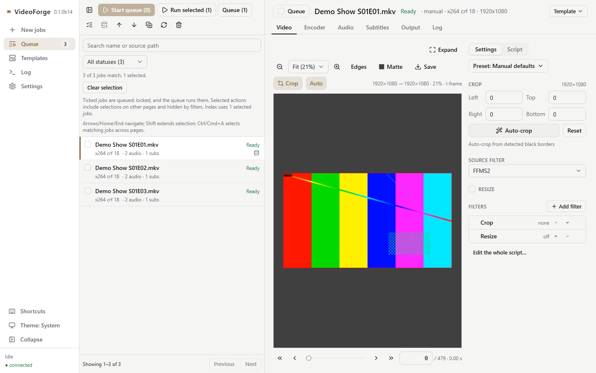
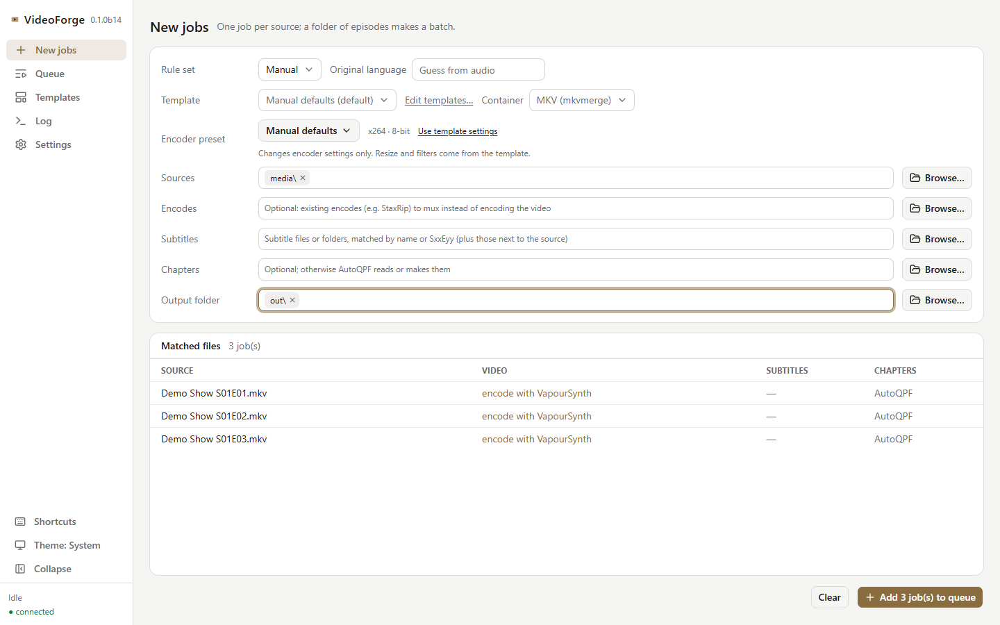
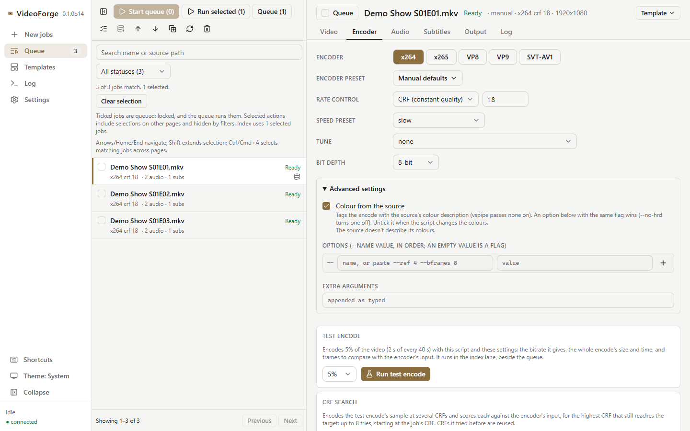
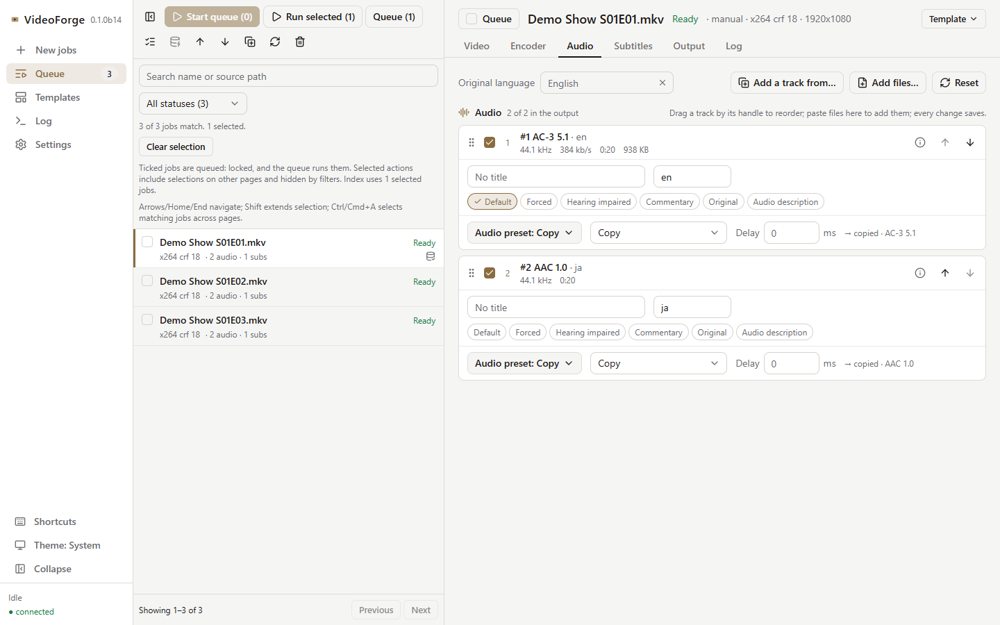
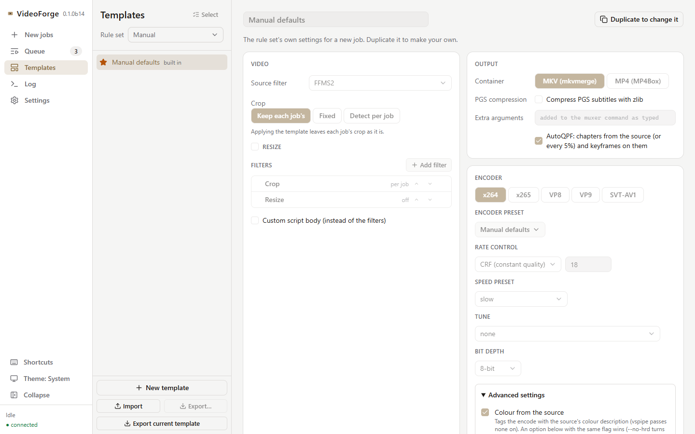

# VideoForge

An encode and mux job queue that runs in your browser, in the spirit of StaxRip. Queue one source or a season of episodes, and each job runs end to end:

```text
index → VapourSynth (crop, resize, filters) → x264 / x265 / VP8 / VP9 / SVT-AV1 → audio → subtitles → mux (MKV or MP4) → validate
```

[Documentation](https://jessielw.github.io/VideoForge/) · [Getting started](https://jessielw.github.io/VideoForge/getting-started/) · [Releases](https://github.com/jessielw/VideoForge/releases) · [Changelog](CHANGELOG.md)

<picture>
  <source media="(prefers-color-scheme: dark)" srcset="docs/assets/screenshots/video-dark.png">
  
</picture>

## Features

- **Video:** frame preview with zoom and a crop overlay, auto crop, resize, a CPU filter chain, and a generated VapourSynth script you can edit. Encode with x264, x265, VP8, VP9 or SVT-AV1, in 1 or 2 passes, with test encodes and CRF search.
- **Audio and subtitles:** keep, drop, reorder, retitle and flag tracks. Copy or encode each audio track (FLAC, Opus, AAC, AC-3, E-AC-3, DDP and Atmos), and make several outputs from one track.
- **Output:** MKV or MP4, chapters, AutoQPF, and a validation pass before the file is published.
- **Queue:** batch import, background batch indexing, pause and resume, and per-step reuse: finished steps are skipped on a rerun. Jobs survive restarts.
- **Templates:** save a whole setup and apply it to every episode. Audio and subtitles can be picked by position or by rules (language, codec, channels, forced / SDH / commentary).
- **HDR:** HDR10, HDR10+ and Dolby Vision (profile 8.1, a MEL or FEL as 8.1, profile 5 as 5) for x265 encodes.
- **Automation:** notifications, command and webhook actions, and Python plugins and rule sets.

<table><tr><td><a href="docs/assets/screenshots/new-jobs.png"><picture>   <source media="(prefers-color-scheme: dark)" srcset="docs/assets/screenshots/new-jobs-dark.png">    </picture></a></td><td><a href="docs/assets/screenshots/encoder.png"><picture>   <source media="(prefers-color-scheme: dark)" srcset="docs/assets/screenshots/encoder-dark.png">    </picture></a></td></tr><tr><td><a href="docs/assets/screenshots/audio.png"><picture>   <source media="(prefers-color-scheme: dark)" srcset="docs/assets/screenshots/audio-dark.png">    </picture></a></td><td><a href="docs/assets/screenshots/templates.png"><picture>   <source media="(prefers-color-scheme: dark)" srcset="docs/assets/screenshots/templates-dark.png">    </picture></a></td></tr></table>

## Install

| You want | Do this |
| --- | --- |
| Windows, nothing to install | Unzip `VideoForge-<version>-windows-x64.zip` from [Releases](https://github.com/jessielw/VideoForge/releases) and run `VideoForge.exe`. [Guide](https://jessielw.github.io/VideoForge/getting-started/windows/) |
| Linux | Run the Docker image: set your media folder in [compose.yaml](compose.yaml), then `docker compose up -d` and open http://127.0.0.1:8765. [Guide](https://jessielw.github.io/VideoForge/getting-started/docker/) |
| A source checkout | See [From source](#from-source). [Guide](https://jessielw.github.io/VideoForge/getting-started/source/) |

The portable build and the Docker image include the free tools and VapourSynth plugins. Only Dolby Encoding Engine (DDP / Atmos) and Apple's CoreAudioToolbox (qaac AAC) are yours to supply. [Tools and plugins](https://jessielw.github.io/VideoForge/configuration/tools/) lists everything and where it goes.

### From source

Needs Python 3.12+, [uv](https://docs.astral.sh/uv/), Git and Node.js. On Windows x64:

```powershell
git clone https://github.com/jessielw/VideoForge
cd VideoForge
uv run python scripts/setup_windows.py   # Python extras, free tools and plugins, the frontend
uv run videoforge serve --tray
```

On Linux, use Docker, or provide the tools and plugins yourself and point VideoForge at them. macOS and Linux ARM64 are experimental, self-managed source setups ([guide](https://jessielw.github.io/VideoForge/getting-started/source/#macos-and-arm64)).

To build the frontend and run without the setup script:

```bash
uv sync
cd frontend && npm install && npm run build && cd ..
uv run videoforge serve          # http://127.0.0.1:8765
```

`--tray` runs VideoForge from a tray icon (Open for the page, Quit to stop; `uv sync --extra desktop`). A browser never reveals a dropped file's path, so paste paths instead: in Explorer select the files, press **Ctrl+Shift+C**, then **Ctrl+V** in the path field.

## Your first job

1. **New jobs:** add a source (or a folder of episodes), pick a template, set an output folder, and add it to the queue.
2. **Queue:** select the job, **Index now**, then check the **Video** tab: crop, resize, filters.
3. **Encoder, Audio, Subtitles, Output:** choose the encoder and rate control, then the tracks and the container.
4. **Run selected** for one job, or tick jobs and **Start queue**.

[Your first job](https://jessielw.github.io/VideoForge/getting-started/first-job/) covers each step.

## Where things go

- **Next to the source, `<source>_tmp/`:** each job's work folder: index, script, encodes, log, and a job record (how the output was made). A rerun reuses it.
- **Output folder:** the finished file, written as `<output>.partial` and validated before it's published.
- **`%APPDATA%\VideoForge`** (or `--data-dir`): the queue database, templates, settings and logs.

See [Storage and backups](https://jessielw.github.io/VideoForge/configuration/storage/) and [Job records](https://jessielw.github.io/VideoForge/job-record/).

## Limits

- Sources are MKV, MP4 and M2TS / TS. Remux anything else to MKV first.
- Filters run on the CPU; there are no GPU filters yet.
- Dolby Vision 8.4 (HLG) isn't supported.
- There's no login. Keep it on `127.0.0.1` or behind your own authenticating proxy ([Docker guide](https://jessielw.github.io/VideoForge/getting-started/docker/#network-access)).

## Rule sets and plugins

A rule set decides what goes into the output: which tracks, copy or encode, titles, flags, and the checks on the finished file. VideoForge ships one, `manual` (every source track in source order, copied; you change what you want). Other rule sets and plugins are Python packages: see [Rule sets](https://jessielw.github.io/VideoForge/development/rule-sets/) and [Plugins](https://jessielw.github.io/VideoForge/plugins/).

## Development

```bash
uv run videoforge serve --no-browser     # the backend
cd frontend && npm run dev               # http://localhost:5173, proxies /api
uv run pytest -q                         # Python tests
cd frontend && npm run check             # frontend checks
uv run poe typecheck                     # basedpyright
uv run poe lint                          # ruff
uv run poe format                        # ruff fixes, then format
```

Preview the docs with `uv run --only-group docs --frozen zensical serve` (http://localhost:8000). More in [Contributing](https://jessielw.github.io/VideoForge/development/contributing/) and [ARCHITECTURE.md](ARCHITECTURE.md).

## License

[MIT](LICENSE)
